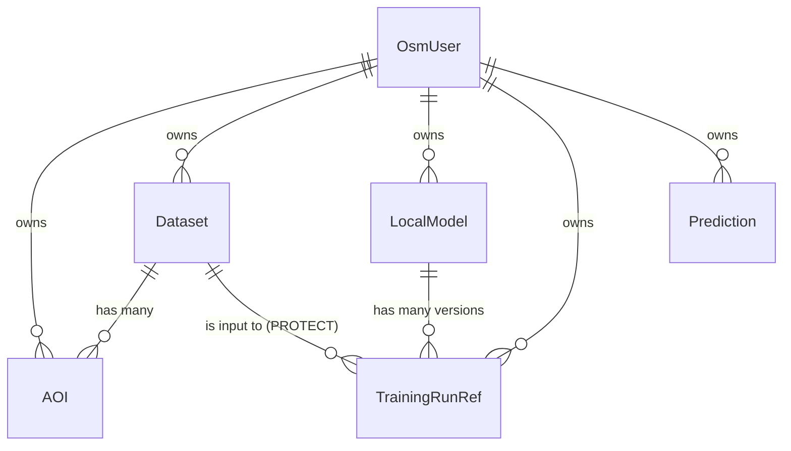

# Backend

The backend is a Django REST Framework service organized into feature apps. It owns one Postgres database (`fair`); ZenML, MLflow, and the model pipelines write to their own databases on the same instance.

## Apps

| App             | Responsibility                                                                                                                                                                                                                                                           |
| --------------- | ------------------------------------------------------------------------------------------------------------------------------------------------------------------------------------------------------------------------------------------------------------------------ |
| `accounts`      | Custom `OsmUser` keyed by `osm_id`. Supports a static dev token and Hanko SSO. Deleting a user in the Django admin removes their private records and files, including unpublished models and their runs, and moves public or in-use records to a "Deleted user" account. |
| `datasets`      | `Dataset` (a pointer to a STAC item) and `AOI` (a PostGIS polygon). Async build downloads imagery tiles and OSM labels, uploads chips and `labels.geojson`, and registers the STAC item.                                                                                 |
| `modelregistry` | `Category`, `BaseModel` (a pretrained model family), and `LocalModel` (a finetuned family). Endpoints for base models, local models, and categories.                                                                                                                     |
| `trainings`     | `TrainingRunRef`, one row per finetune run, with the hyperparameter overrides and status. Submits ZenML pipelines and polls their state.                                                                                                                                 |
| `predictions`   | `Prediction`, with the geometry, zoom, params, and a `results_ready` flag. Post-processes GeoJSON into `.fgb` and `.pmtiles`. Deleting a finished prediction in the Django admin also removes its stored files.                                                              |
| `feedback`      | `Feedback`, accept and reject labels on predicted features. Posted at `/api/v1/feedback/` for a registered model's STAC id. The author, the model's owner and admins read a label; the author or an admin edits or deletes it. KPI and profile counts read it.           |
| `notifications` | Site-wide announcement banners, managed in the Django admin and listed publicly.                                                                                                                                                                                         |
| `stars`         | Starring a model or dataset. Star counts are public; starring needs a signed-in user.                                                                                                                                                                                    |
| `system`        | Health and KPI endpoints.                                                                                                                                                                                                                                                |
| `shared`        | Cross-cutting helpers: enums, exceptions, validators, storage, and the integrations layer.                                                                                                                                                                               |
| `config`        | Django project settings, URL routing, and environment parsing.                                                                                                                                                                                                           |

Enums live in `shared/enums.py` as Django `TextChoices` and are imported by the models, rather than redefined per app.

## The fair integration layer

The heavy ML work is handled by the external `fair` package (`fair-py-ops`), which wraps ZenML and STAC. The backend calls it through `shared/integrations/`:

- `integrations/zenml.py` wraps the fair client and run helpers. It builds a process-wide client for the worker and a user-scoped client for owner actions.
- `integrations/stac.py` wraps the STAC backend with a short-lived cache. Property changes are read-modify-write, since the STAC API has no PATCH. It also mirrors downloadable assets into the bucket and repoints their URLs at a presign proxy.

## Database schema

The tables hold ownership and lifecycle state and point at STAC items; per-version metadata stays in STAC. Each app's `models.py` holds every field.

`visibility` controls access through the fAIr API only. A private dataset, local model or prediction is hidden from other users in fAIr's lists, search and detail endpoints. Its STAC item and download links in the open STAC catalog stay reachable to anyone who has them.

The endpoints are on [API](api.md).
