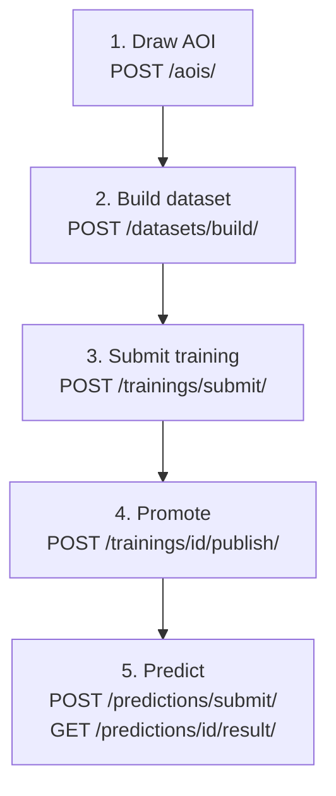

# Architecture

fAIr is a Django REST backend, a React single-page app, and an ML layer built on ZenML, a STAC catalog, MinIO, and MLflow. The backend is a thin coordinator: it persists ownership and lifecycle in Postgres, validates inputs, and delegates the heavy work (tile and label downloads, training, inference) to async workers and a ZenML server.

## Components

| Component                                | Role                                                                                                                                                         |
| ---------------------------------------- | ------------------------------------------------------------------------------------------------------------------------------------------------------------ |
| **Backend** (Django REST)                | Owns dataset, training, and prediction orchestration. Persists ownership and status in Postgres, submits pipelines, polls status. See [Backend](backend.md). |
| **Frontend** (React SPA)                 | The web app mappers use to browse models, run predictions, and manage training. See [Frontend](frontend.md).                                                 |
| **STAC catalog** (pgSTAC + stac-fastapi) | Source of truth for datasets, base models, and local models, including assets and metadata.                                                                  |
| **MinIO** (S3-compatible)                | Artifact store for chips, labels, weights, ONNX models, and prediction outputs.                                                                              |
| **MLflow**                               | Experiment tracking for training runs.                                                                                                                       |
| **ZenML**                                | Orchestrates the training and inference pipelines and tracks run state.                                                                                      |
| **Knative**                              | Serves one digest-pinned inference service per base model, with separate staging and live routes.                                                            |

The ML pipeline and how these services fit together are described in [ML pipeline](ml-pipeline.md).

## End-to-end flow

A full run is five stages: draw an area of interest, build a dataset, train, promote the result, and predict.

Behind each stage:

| Step                   | What the backend does                                                                                                                                                                              | Output                                                                                                                                              |
| ---------------------- | -------------------------------------------------------------------------------------------------------------------------------------------------------------------------------------------------- | --------------------------------------------------------------------------------------------------------------------------------------------------- |
| **1. AOI**             | Validates polygon, stores in postgres.                                                                                                                                                             | Row in `datasets_aoi`.                                                                                                                              |
| **2. Build dataset**   | Async worker downloads the tiles of each model input + labels from OSM or `labels_url` for the AOI, uploads chips + `labels.geojson` to MinIO, registers a STAC item under `datasets/`.            | Built STAC dataset. Poll `GET /datasets/{id}/` until `status=built`.                                                                                |
| **3. Submit training** | Async worker submits a ZenML pipeline. ZenML schedules an orchestrator + step pods on the autoscaling ml pool (`split`, `train`, `eval`, `onnx`). Worker polls ZenML status into the DB every 30s. | Trained `weights.pt` + `model.onnx` in MinIO. Poll `GET /trainings/{id}/` until `status=completed`. Tail with `GET /trainings/runs/{run_id}/logs/`. |
| **4. Promote**         | API builds a versioned STAC `local-models/` item from the run's hyperparameters + asset URLs, validates against the base-model's `fair:hyperparameters_spec`, publishes.                           | `local_model_stac_id`.                                                                                                                              |
| **5. Predict**         | Async worker downloads chips for the requested bbox, submits an inference pipeline, then post-processes the geojson into `.fgb` + `.pmtiles` via tippecanoe.                                       | Three presigned URLs at `GET /predictions/{id}/result/` once `results_ready=true`.                                                                  |

## Key invariants

- **Datasets, base models, and local models are STAC items.** The Postgres tables are thin pointers that hold ownership and lifecycle state. Per-version metadata (assets, hyperparameter specs, training image) lives only in STAC.
- **Training and prediction are async.** The `POST /.../submit/` endpoints return `202` plus a row whose `zenml_run_id` is null until the worker submits the pipeline. Status runs `initializing`, `submitted`, `provisioning`, `running`, then `completed` or `failed`.
- **`results_ready` is separate from `status`.** A prediction's outputs (`.fgb` and `.pmtiles`) are materialized by a post-run step after ZenML reports completion. Until then, `/predictions/{id}/result/` returns `409`.
- **Publish is the only step that writes a versioned local-model STAC item.** It validates logged hyperparameters against the base model's `fair:hyperparameters_spec`, and fails on a logged key the spec doesn't declare, so the spec lists every key the training image logs.

## API and schema

See [API](api.md) for the endpoints and [Backend](backend.md#database-schema) for the database schema.
