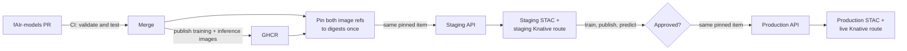

# Infrastructure and deployment

HOT's standard deployment process for other apps is documented in the [DevOps deployment guide](https://docs.hotosm.org/devops/deployment-process). fAIr differs slightly, because it has:

- Versioning of both software, as well as AI models.
- A dedicated dev instance EC2 for easier development with all components.

Model development happens in the `fAIr-models` repo. A CI matrix workflow builds
training and inference images for each model when it changes. An admin pins a
copy of the model's STAC item to image digests once (`fair basemodel pin`) and
registers that same item in staging and then production; what registration does
is described in [Register a base model](../guides/register-a-base-model.md#what-registration-does).

The backend image bundles `models/` from the same `fAIr-models` release as its
`fair-py-ops` dependency. Registration rejects a pipeline module that is not in
that bundle, so pipeline-code changes require a backend release; metadata,
weights, and inference-image-only changes do not.

## Step 1: Development

The development instance, how it tracks the `develop` branch and how it is
redeployed are described in [Dev environment](dev-environment.md). Models under
development use the `dev` and `dev-inference` images built for their pull
request and are registered on the dev instance through the API.

## Step 2: Staging

!!! note "The environment"

    - Runs all the same components as production, but starts up via a PR from
      `stage` to `main`.
    - The components run inside the `fair-staging` namespace of the Kubernetes
      cluster, under domain `https://stage.ai.hotosm.org`.
    - Does not run its own `knative` controller, instead using the cluster-wide
      instance.

1. When we want to stabilise and push out a **new model**, or **updates to the
   API / website**, we use the staging setup.
2. First a PR must be raised on the fAIr repo from `stage` --> `main`.
   This will set up `https://stage.ai.hotosm.org` with ZenML / STAC /
   Knative registration.
3. The **staging** STAC is separate from production and persists between PRs.
4. After merge, pin both image references in a copy of the STAC item with
   `fair basemodel pin`. Register that file through the staging API. It is
   served at `https://staging-<model>.predict.ai.hotosm.org` without changing
   production traffic. Then test training, publishing, and prediction.
5. Once it looks good, register the model in production (Step 3) before merging
   the PR to `main`. Merging shuts the staging env down.

## Step 3: Production

!!! note "The environment"

    - Runs through tagged releases on GitHub, where ArgoCD picks up the latest
      Helm chart tag and deploys.

Follow the [release checklist](../community/contributing.md#releases).

1. Publish a GitHub release from the latest `main` code and wait for its
   versioned API and frontend images to finish publishing.
2. Update the chart on `develop` only after those images exist. Publishing the
   chart triggers ArgoCD to deploy the fAIr website / API.
3. Register the exact pinned STAC item tested in staging through the production
   API. This publishes the next integer STAC version and moves live traffic to
   the Ready revision. The images are already in GHCR.
