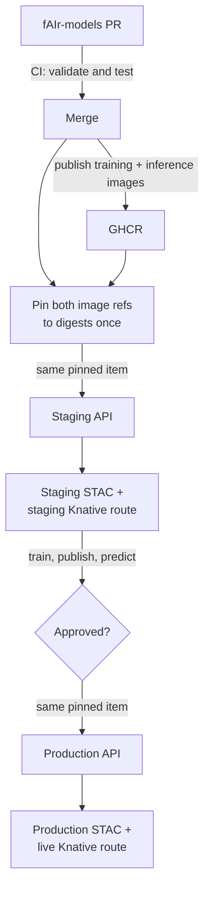

# Infrastructure and deployment

HOT's standard deployment process for other apps is documented in the [DevOps deployment guide](https://docs.hotosm.org/devops/deployment-process). fAIr differs slightly, because it has:

- Versioning of both software, as well as AI models.
- A dedicated dev instance EC2 for easier development with all components.

Model development happens in the `fAIr-models` repo. A CI matrix workflow builds
training and inference images for each model when it changes. An admin pins a
copy of the model's STAC item to image digests once (`fair basemodel pin`) and
registers that same item in staging and then production; what registration does
is described in [Register a base model](../guides/register-a-base-model.md#what-registration-does).



The backend image bundles `models/` from the same `fAIr-models` release as its
`fair-py-ops` dependency. Registration rejects a pipeline module that is not in
that bundle, so pipeline-code changes require a backend release; metadata,
weights, and inference-image-only changes do not.

The cluster manifests and topology are in [`fAIr-models/infra/`](https://github.com/hotosm/fAIr-models/tree/main/infra).

## Step 1: Development

The development instance, how it tracks the `develop` branch and how it is
redeployed are described in [Dev environment](dev-environment.md). Models under
development use the `dev` and `dev-inference` images built for their pull
request and are registered on the dev instance through the API.

## Step 2: Staging

!!! note "The environment"

    - Runs all the same components as production, but starts up via a PR from
      `stage` to `main`.
    - The components run inside the `fair-staging` namespace of the Kubernetes
      cluster, under domain `https://stage.ai.hotosm.org`.
    - Does not run its own `knative` controller, instead using the cluster-wide
      instance.

1. When we want to stabilise and push out a **new model**, or **updates to the
   API / website**, we use the staging setup.
2. First a PR must be raised on the fAIr repo from `stage` to `main`.
   This will set up `https://stage.ai.hotosm.org` with ZenML / STAC /
   Knative registration.
3. The **staging** STAC is separate from production and persists between PRs.
4. After merge, pin both image references in a copy of the STAC item with
   `fair basemodel pin`. Register that file through the staging API. It is
   served at `https://staging-<model>.predict.ai.hotosm.org` without changing
   production traffic. Then test training, publishing, and prediction.
5. Once it looks good, register the model in production (Step 3) before merging
   the PR to `main`. Merging shuts the staging env down.

## Step 3: Production

!!! note "The environment"

    - Runs through tagged releases on GitHub, where ArgoCD picks up the latest
      Helm chart tag and deploys.

Follow the [release checklist](../community/contributing.md#releases).

1. Publish a GitHub release from the latest `main` code and wait for its
   versioned API and frontend images to finish publishing.
2. Update the chart on `develop` only after those images exist. Publishing the
   chart triggers ArgoCD to deploy the fAIr website / API.
3. Register the exact pinned STAC item tested in staging through the production
   API. This publishes the next integer STAC version and moves live traffic to
   the Ready revision. The images are already in GHCR.

## Helm chart

The chart in `chart/` deploys the fAIr backend API, its django_tasks worker and, optionally, the frontend SPA.

PostgreSQL comes from outside the chart, for example [CloudNativePG](https://cloudnative-pg.io/) or a managed database. A bundled single-pod Postgres serves staging, PR previews and local tests.

### Quick start

```bash
helm install fair oci://ghcr.io/hotosm/charts/fair
```

### Example values

```yaml
externalDatabase:
  host: my-pg-cluster-rw.db.svc
  database: ai
  username: fair
  existingSecret: fair-db-credentials
  existingSecretKey: password

ingress:
  enabled: true
  className: nginx
  hosts:
    - host: fair.example.com
      paths:
        - path: /
          pathType: Prefix

backend:
  envFrom:
    - secretRef:
        name: fair-backend-secrets
```

### Key values

| Parameter | Description | Default |
|---|---|---|
| `externalDatabase.host` | PostgreSQL host | `""` |
| `externalDatabase.existingSecret` | Secret containing DB password | `""` |
| `backend.djangoQ.enabled` | Run the django_tasks worker (`manage.py db_worker`) sidecar | `true` |
| `backend.migrate.enabled` | Run migrations on install/upgrade | `true` |
| `backend.knativeReconcile.enabled` | Enable periodic Knative reconciliation | `false` |
| `backend.knativeReconcile.schedule` | Reconciliation schedule | `*/15 * * * *` |
| `backend.knativeReconcile.prune` | Remove Knative services not in STAC | `false` |
| `ingress.enabled` | Create Ingress resource | `false` |
| `serviceAccount.knativeRbac` | Role/RoleBinding to manage Knative Services in the release namespace | `true` |
| `frontend.mode` | `"bundleWithBackend"` or `"cloudfront"` | `"bundleWithBackend"` |

The reconciler restores services from active STAC base models. Keep `prune`
disabled until fair-py-ops follows all STAC pagination links; jobs forbid
overlap and stop after one hour.

### Frontend

The SPA is delivered by the `fair/frontend` image (`frontend/Dockerfile.prod`),
an init container that copies the built assets into a shared volume and exits. `frontend.mode` picks how they're served:

- **`bundleWithBackend`** (default): the backend pod serves the SPA at `/` via
  Django + WhiteNoise (`SERVE_FRONTEND=true`, set by the chart); API stays on
  `/api`. This uses one pod, one Service and one ingress path, and suits staging, PR previews
  and self-hosted deploys without AWS.
- **`cloudfront`**: a post-install/upgrade Job syncs the SPA to S3 and
  creates/updates a CloudFront distribution, authenticating via IRSA
  (`frontend.cloudfront.roleArn`). Frontend and API live on separate domains
  (e.g. `fair.example.com` and `api.fair.example.com`). See `values.yaml` for the
  full `frontend.cloudfront.*` options.

Runtime config is injected at container start (written to `config.js`), so the
same image runs in any environment without a rebuild. For CloudFront
deployments, set `frontend.runtimeEnv.VITE_BASE_API_URL` to the absolute backend
API URL. The default build-time value remains `/api/v1/` for same-origin
deployments.

### CloudFront mode

The post-install/upgrade Job:

1. Syncs the frontend to a versioned S3 path.
2. Finds or creates the CloudFront distribution and Origin Access Control.
3. Updates the distribution to the new version and invalidates its cache.

`403`/`404` return `/index.html` with a `200`, so client-side routes work.

#### CloudFront values

| Parameter | Description | Default |
|---|---|---|
| `frontend.cloudfront.roleArn` | IAM role ARN for IRSA (**required**) | `""` |
| `frontend.cloudfront.s3Bucket` | S3 bucket name (**required**) | `""` |
| `frontend.cloudfront.region` | AWS region | `"us-east-1"` |
| `frontend.cloudfront.version` | S3 path prefix; defaults to `appVersion` | `""` |
| `frontend.cloudfront.aliases` | Custom domain aliases | `[]` |
| `frontend.cloudfront.acmCertificateArn` | ACM certificate ARN (required with `aliases`) | `""` |
| `frontend.cloudfront.priceClass` | CloudFront price class | `"PriceClass_All"` |

Each release remains in S3. To roll back, set `frontend.cloudfront.version` to a
previous app version and re-sync.

#### CloudFront setup

Before the first deployment:

1. Create an S3 bucket.
2. For a custom domain, create and validate an ACM certificate in `us-east-1`.
3. Create an IRSA role trusted by the chart's service account, with permission
   to manage the bucket, distribution, Origin Access Control, and invalidations.
4. Set the CloudFront values and deploy. The Job creates the distribution.
5. Point the frontend domain to the distribution with a Route53 alias.

The Job uses IRSA and does not accept static AWS keys. If
`serviceAccount.create` is `false`, annotate the existing service account with
the role ARN yourself.

#### HOT deployment

Production's S3 bucket and AWS resources are created with OpenTofu in the k8s-infra repository.

## ZenML image and CLI

The `infra/zenml` image patches ZenML OSS, which supports MySQL and SQLite, to run on Postgres: it installs `psycopg` and replaces MySQL-only types such as `MEDIUMTEXT`. Build and run it with `docker compose -f infra/zenml/compose.yml build zenml` and `docker compose -f infra/zenml/compose.yml run zenml`, or with the image build workflow in GitHub Actions, which builds multi-arch images for a given ZenML version. With the ZenML Helm chart, set `zenml.database.backupStrategy=disabled`, because its backup uses MySQL tools; CloudNativePG backs up Postgres.

The `fair-cli` image (`Dockerfile.cli`) bundles the patched ZenML CLI with `tofu`,
`aws`, `kubectl`, `kubeseal` and `helm`. Use it to apply the ZenML stacks, following
`apps/fair/zenml/opentofu/README.md` in k8s-infra.

Its tag must match the server's ZenML version, which is the chart `targetRevision`.
Add this alias to your bashrc or fish config:

```sh
export ZENML_VERSION=0.94.2
# For fish: set -x ZENML_VERSION 0.94.2

alias fair-cli='sh -c '"'"'
if [ -z "${ZENML_VERSION:-}" ]; then
  echo "Set ZENML_VERSION to the matching ZenML version, e.g. ZENML_VERSION=0.94.2" >&2
  exit 1
fi

if docker ps --format "{{.Names}}" | grep -qx "fair-cli"; then
  exec docker exec -it fair-cli fish
fi

exec docker run --rm -it --name fair-cli \
  -v "$PWD:$PWD" \
  -v "$HOME/.aws:/root/.aws" \
  -v "$HOME/.kube:/root/.kube" \
  -v "$HOME/.local/share/fish/fish_history:/root/.local/share/fish/fish_history" \
  -v "$HOME/.config/fish/config.fish:/opt/fish/user-config.fish" \
  -v /var/run/docker.sock:/var/run/docker.sock \
  --workdir "$PWD" \
  --network host \
  ghcr.io/hotosm/fair/cli:${ZENML_VERSION}
'"'"''
```

Source the file, then run via the alias:

```sh
fair-cli
```
