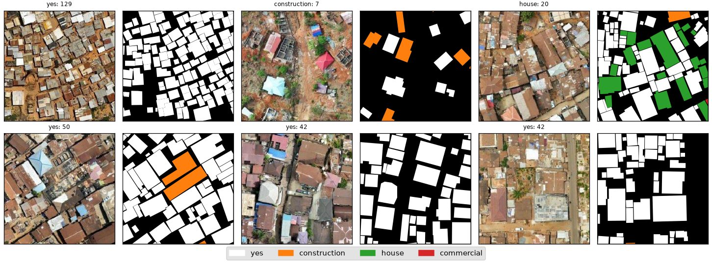
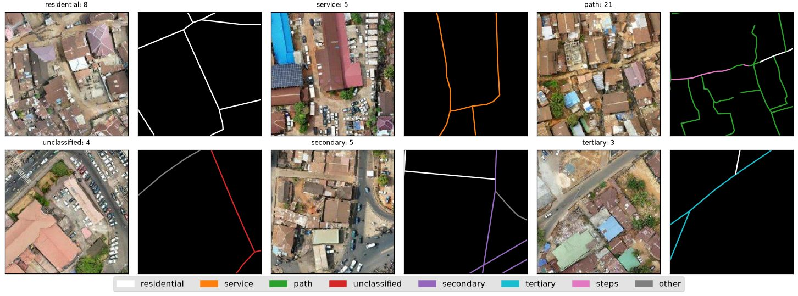
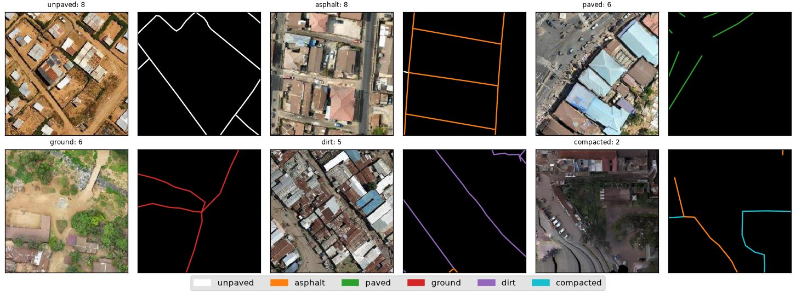
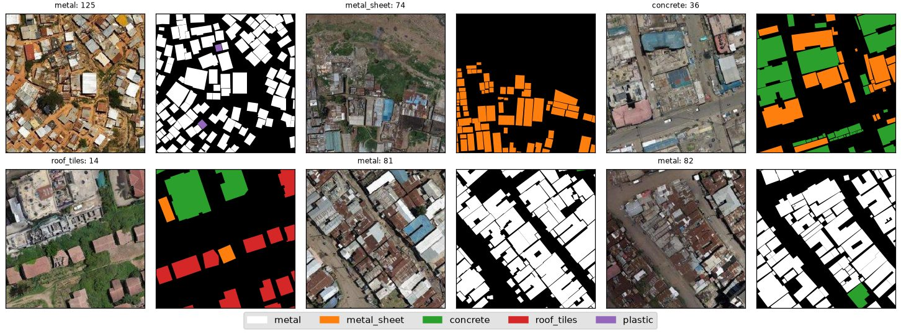
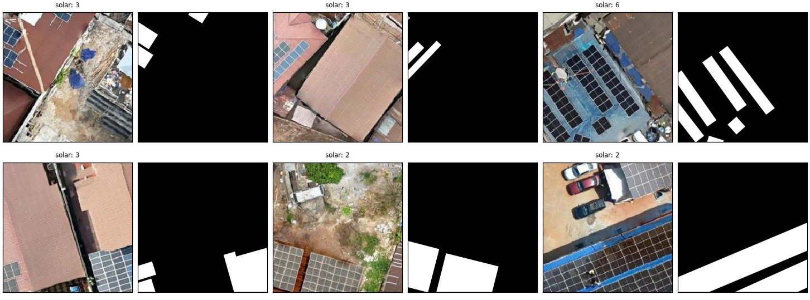
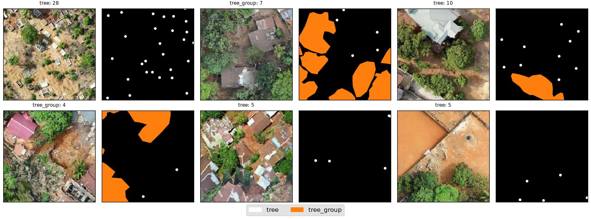
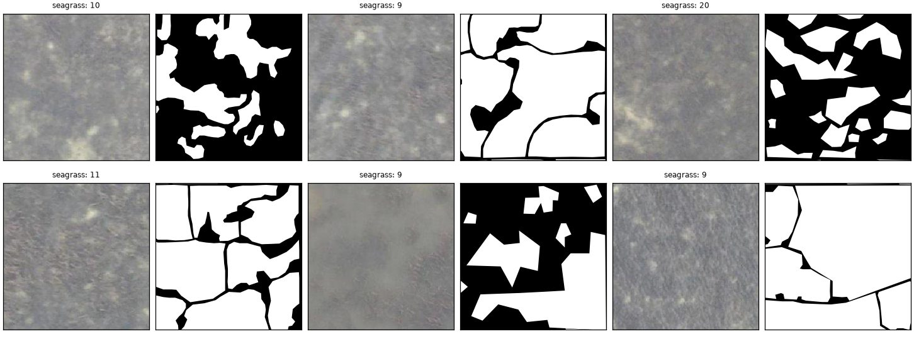
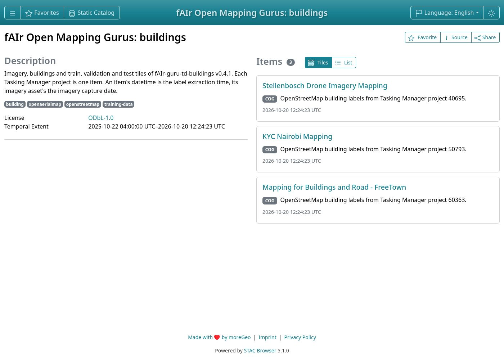
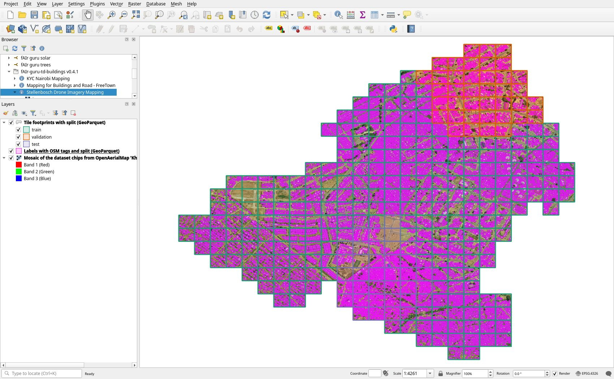

# Datasets

fAIr's models are trained on open datasets, and validated predictions are published as open data. This page explains how training data is created and lists the datasets HOT publishes on [Hugging Face](https://huggingface.co/hotosm) and the [Humanitarian Data Exchange](https://data.humdata.org/).

Most datasets combine imagery under CC-BY-4.0 with labels derived from OpenStreetMap under the ODbL (the Open Database License).

## How training data is created

Training labels come from mapping in the [Tasking Manager](https://tasks.hotosm.org/) and from [MapSwipe](https://mapswipe.org/), and community mappers in the Open Mapping Gurus program create datasets that are released openly. Their deployments are listed [below](#open-mapping-gurus), and fAIrSwipe projects are on the [Field projects](../progress/field-projects.md) page.

## Open Mapping Gurus

Community mappers in the Open Mapping Gurus program, facilitated by HOT regional hubs (WNA: West and Northern Africa; ESA: Eastern and Southern Africa; LAC: Latin America and the Caribbean; AP: Asia-Pacific), map training data on the Tasking Manager. Each completed deployment links its released training datasets, described under [Open Mapping Gurus datasets](#open-mapping-gurus-datasets). Deployment status as of 13 October 2026.

| #  | Location                             | Hub | Features                                                                                                                              | Status   | Tasking Manager                                                                                                                                                                                        | Training datasets                                                                                                                                                                                                                                                                                                                                                              |
| -- | ------------------------------------ | --- | ------------------------------------------------------------------------------------------------------------------------------------- | -------- | ------------------------------------------------------------------------------------------------------------------------------------------------------------------------------------------------------ | ------------------------------------------------------------------------------------------------------------------------------------------------------------------------------------------------------------------------------------------------------------------------------------------------------------------------------------------------------------------------------ |
| 1  | Timor-Leste                          | AP  | Seagrass                                                                                                                              | Complete | [55909](https://tasks.hotosm.org/projects/55909), [55908](https://tasks.hotosm.org/projects/55908), [55911](https://tasks.hotosm.org/projects/55911), [55910](https://tasks.hotosm.org/projects/55910) | [seagrass](https://huggingface.co/datasets/hotosm/fAIr-guru-td-seagrass)                                                                                                                                                                                                                                                                                                       |
| 2  | Freetown, Sierra Leone               | WNA | Trees, solar panels, buildings (roof type and colour), highways                                                                       | Complete | [50661](https://tasks.hotosm.org/projects/50661), [60363](https://tasks.hotosm.org/projects/60363)                                                                                                     | [buildings](https://huggingface.co/datasets/hotosm/fAIr-guru-td-buildings), [highways](https://huggingface.co/datasets/hotosm/fAIr-guru-td-highways), [road surface](https://huggingface.co/datasets/hotosm/fAIr-guru-td-road-surface), [trees](https://huggingface.co/datasets/hotosm/fAIr-guru-td-trees), [solar](https://huggingface.co/datasets/hotosm/fAIr-guru-td-solar) |
| 3  | Nairobi, Kenya                       | ESA | Buildings (roof type and colour), highways (surface type)                                                                             | Complete | [50793](https://tasks.hotosm.org/projects/50793)                                                                                                                                                       | [buildings](https://huggingface.co/datasets/hotosm/fAIr-guru-td-buildings), [highways](https://huggingface.co/datasets/hotosm/fAIr-guru-td-highways), [road surface](https://huggingface.co/datasets/hotosm/fAIr-guru-td-road-surface), [roof type](https://huggingface.co/datasets/hotosm/fAIr-guru-td-roof-type)                                                             |
| 4  | Stellenbosch, South Africa           | ESA | Buildings (roof type and colour), highways (surface type)                                                                             | Complete | [40695](https://tasks.hotosm.org/projects/40695)                                                                                                                                                       | [buildings](https://huggingface.co/datasets/hotosm/fAIr-guru-td-buildings), [highways](https://huggingface.co/datasets/hotosm/fAIr-guru-td-highways), [road surface](https://huggingface.co/datasets/hotosm/fAIr-guru-td-road-surface), [roof type](https://huggingface.co/datasets/hotosm/fAIr-guru-td-roof-type)                                                             |
| 5  | Bogotá, Colombia                     | LAC | Buildings (roof type and colour), highways (surface type), water tanks, sports facilities, trees                                      | Ongoing  | [66831](https://tasks.hotosm.org/projects/66831)                                                                                                                                                       |                                                                                                                                                                                                                                                                                                                                                                                |
| 6  | Payatas, Quezon City, Philippines    | AP  | Buildings (roof type and colour), highways (surface type), streetlights, electric posts, coconut trees, solar panels                  | Ongoing  | [65381](https://tasks.hotosm.org/projects/65381), [65412](https://tasks.hotosm.org/projects/65412), [65413](https://tasks.hotosm.org/projects/65413), [65414](https://tasks.hotosm.org/projects/65414) |                                                                                                                                                                                                                                                                                                                                                                                |
| 7  | Borongan, Eastern Samar, Philippines | AP  | Buildings (roof type and colour), highways (surface type), zebra crossings, solar panels, swimming pools                              | Ongoing  | [49805](https://tasks.hotosm.org/projects/49805), [49839](https://tasks.hotosm.org/projects/49839), [49838](https://tasks.hotosm.org/projects/49838), [49837](https://tasks.hotosm.org/projects/49837) |                                                                                                                                                                                                                                                                                                                                                                                |
| 8  | Monkayo, Davao de Oro, Philippines   | AP  | Buildings (roof type and colour), highways (surface type), zebra crossings, streetlights, electric posts, coconut trees, solar panels | Ongoing  | [66864](https://tasks.hotosm.org/projects/66864)                                                                                                                                                       |                                                                                                                                                                                                                                                                                                                                                                                |
| 9  | Zimbabwe                             | ESA | Buildings (roof type and colour), highways (surface type)                                                                             | Ongoing  | [66897](https://tasks.hotosm.org/projects/66897)                                                                                                                                                       |                                                                                                                                                                                                                                                                                                                                                                                |
| 10 | Malawi                               | ESA | Buildings (roof type and colour), highways (surface type)                                                                             | Ongoing  | [67128](https://tasks.hotosm.org/projects/67128)                                                                                                                                                       |                                                                                                                                                                                                                                                                                                                                                                                |
| 11 | Sanur, Bali, Indonesia               | AP  | Parking lots, solar panels, swimming pools, trees                                                                                     | Planned  |                                                                                                                                                                                                        |                                                                                                                                                                                                                                                                                                                                                                                |
| 12 | Parang Island, Mindoro, Philippines  | AP  | To be confirmed                                                                                                                       | Planned  |                                                                                                                                                                                                        |                                                                                                                                                                                                                                                                                                                                                                                |

## Training datasets

Datasets used to train and evaluate geo-AI models, hosted on Hugging Face. Download totals are on [Milestones](../progress/milestones.md#platform-and-data).

| Dataset                                                                                                 | Feature              | Task                                     | License         |
| ------------------------------------------------------------------------------------------------------- | -------------------- | ---------------------------------------- | --------------- |
| [hot-building-segmentation](https://huggingface.co/datasets/kshitijrajsharma/hot-building-segmentation) | Buildings            | Image segmentation                       | CC-BY-4.0, ODbL |
| [vhr-building-segmentation](https://huggingface.co/datasets/hotosm/vhr-building-segmentation)           | Buildings            | Image segmentation                       | CC-BY-4.0, ODbL |
| [streetlevel-poles](https://huggingface.co/datasets/hotosm/streetlevel-poles)                           | Poles and towers     | Object detection                         | CC-BY-SA-4.0    |
| [vhr-highway-segmentation](https://huggingface.co/datasets/hotosm/vhr-highway-segmentation)             | Highways             | Image segmentation                       | CC-BY-4.0, ODbL |
| [vhr-seagrass-segmentation](https://huggingface.co/datasets/hotosm/vhr-seagrass-segmentation)           | Seagrass             | Image segmentation                       | CC-BY-4.0, ODbL |
| [fAIr-guru-td-buildings](https://huggingface.co/datasets/hotosm/fAIr-guru-td-buildings)                 | Buildings            | Image segmentation                       | CC-BY-4.0, ODbL |
| [fAIr-guru-td-highways](https://huggingface.co/datasets/hotosm/fAIr-guru-td-highways)                   | Highways             | Image segmentation                       | CC-BY-4.0, ODbL |
| [fAIr-guru-td-road-surface](https://huggingface.co/datasets/hotosm/fAIr-guru-td-road-surface)           | Road surface         | Image segmentation, image classification | CC-BY-4.0, ODbL |
| [fAIr-guru-td-roof-type](https://huggingface.co/datasets/hotosm/fAIr-guru-td-roof-type)                 | Building roof type   | Image segmentation, image classification | CC-BY-4.0, ODbL |
| [fAIr-guru-td-solar](https://huggingface.co/datasets/hotosm/fAIr-guru-td-solar)                         | Rooftop solar panels | Image segmentation                       | CC-BY-4.0, ODbL |
| [fAIr-guru-td-trees](https://huggingface.co/datasets/hotosm/fAIr-guru-td-trees)                         | Trees                | Object detection                         | CC-BY-4.0, ODbL |
| [fAIr-guru-td-seagrass](https://huggingface.co/datasets/hotosm/fAIr-guru-td-seagrass)                   | Seagrass             | Image segmentation                       | CC-BY-4.0, ODbL |

The `fAIr-guru-*` datasets come from the Open Mapping Gurus program; `vhr-seagrass-segmentation` holds the Timor-Leste seagrass labels that `fAIr-guru-td-seagrass` is built from. The `streetlevel-poles` dataset is an early experiment with street-level imagery.

### Open Mapping Gurus datasets

Each Guru dataset pairs drone and aerial imagery from [OpenAerialMap](https://openaerialmap.org/) with the features mapped in the deployment's Tasking Manager projects. Tiles come only from task squares marked as validated, and every tile is assigned to a train, validation, or test split. Each release stores its labels with the tiles, so later map edits leave a released dataset unchanged.

Sample tiles beside their labels, from each dataset on Hugging Face:

=== "Buildings"

    

=== "Highways"

    

=== "Road surface"

    

=== "Roof type"

    

=== "Solar"

    

=== "Trees"

    

=== "Seagrass"

    

All Guru datasets are listed in one STAC catalogue. It opens in [STAC Browser](https://browser.moregeo.it/external/huggingface.co/datasets/hotosm/fAIr-guru-stac/raw/main/catalog.json), and in the QGIS STAC panel with this URL:

```text
https://huggingface.co/datasets/hotosm/fAIr-guru-stac/raw/main/catalog.json
```





The datasets are built with [fAIr-ds-builder](https://hotosm.github.io/fAIr-ds-builder/), whose guides cover loading, viewing in STAC Browser or QGIS, custom splits, and building from other Tasking Manager projects.

Quality issues in a dataset, for example found while reviewing a project in QGIS, can be reported on the [fAIr-ds-builder issue tracker](https://github.com/hotosm/fAIr-ds-builder/issues).

## Prediction and crisis outputs

Validated predictions and crisis-response data produced with fAIr, published as open datasets.

On the Humanitarian Data Exchange:

| Dataset                                                                                                                                         | Description                                                                                            | License                                   |
| ----------------------------------------------------------------------------------------------------------------------------------------------- | ------------------------------------------------------------------------------------------------------ | ----------------------------------------- |
| [Nepal Flood 2026: fAIr Damage Assessment, Upper Trishuli and Bhote Koshi](https://data.humdata.org/dataset/hot_flood_npl_buildings_damage)     | Building damage assessment for the flood, produced with fAIr                                           | CC BY (as listed on HDX)                  |
| [Venezuela - M 7.5 Earthquake - Damage Assessment Area](https://data.humdata.org/dataset/venezuela-m-7-5-earthquake-building-damage-assessment) | Damage areas on an H3 grid from fAIr and Microsoft's AI for Good Lab detections, validated in MapSwipe | CC BY-NC-SA 4.0                           |
| [Venezuela - M 7.5 Earthquake - June 2026 - OSM & Overture Data](https://data.humdata.org/dataset/hot_eq_ven)                                   | OSM and Overture layers, with fAIr building predictions and building density                           | ODbL; Overture places CDLA Permissive 2.0 |

On Hugging Face:

| Dataset                                                                       | Description                                       | License       |
| ----------------------------------------------------------------------------- | ------------------------------------------------- | ------------- |
| [venezuela_eq_2026](https://huggingface.co/datasets/hotosm/venezuela_eq_2026) | Venezuela M 7.5 earthquake, June 2026             | Not specified |
| [colombia_eq_2026](https://huggingface.co/datasets/hotosm/colombia_eq_2026)   | Colombia earthquake, August 2026                  | Not specified |
| [nepal_flood_2026](https://huggingface.co/datasets/hotosm/nepal_flood_2026)   | Nepal Flood 2026 (Upper Trishuli and Bhote Koshi) | CC-BY-4.0     |

!!! info "More on HDX"

    Additional fAIr crisis-response outputs are published on the [Humanitarian Data Exchange](https://data.humdata.org/) as responses are run.
