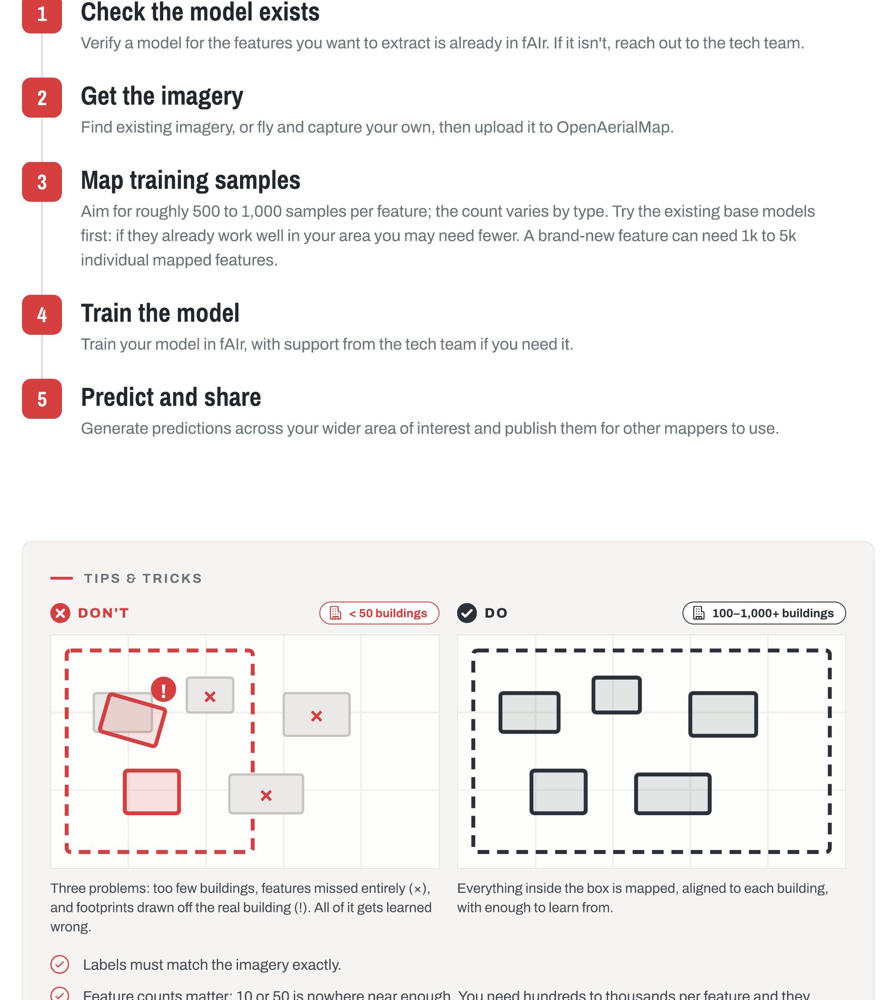
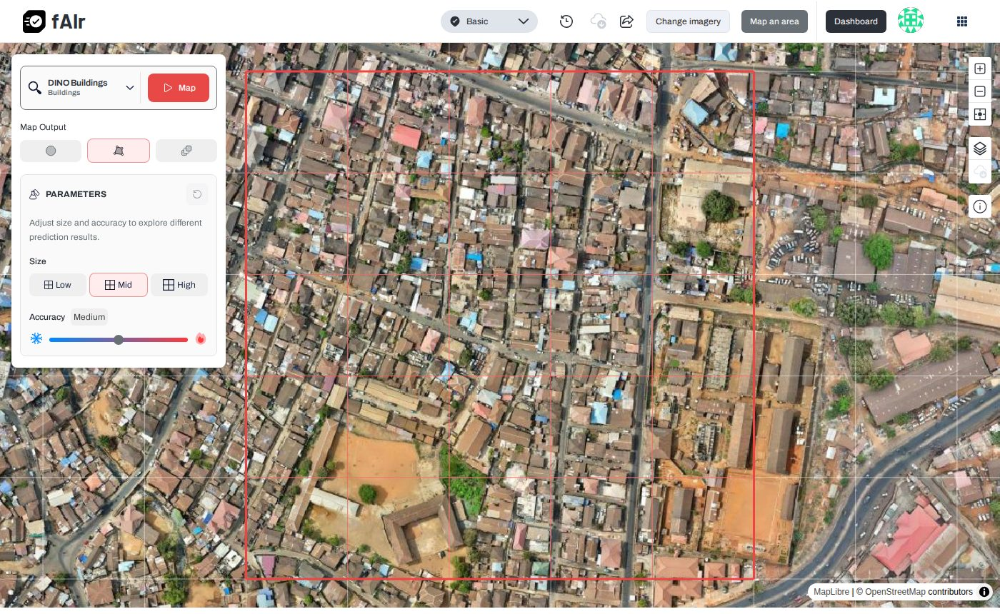

# Using fAIr

This guide covers running a model on your own area with the current version of fAIr at [dev.ai.hotosm.org](https://dev.ai.hotosm.org/). It is aimed at mappers and community project managers.

Running a model works in the interface today. Creating datasets and training local models works through the [API](../architecture/ml-pipeline.md); the **My Datasets** and **My Models** screens are [planned](../roadmap/index.md#now-and-later).

## Before you start

- An account: sign in with your HOT account.
- Imagery of your area on [OpenAerialMap](https://openaerialmap.org/) or another open TMS source, at very high resolution (the buildings model expects about 30 to 50 cm per pixel).
- If you are new to mapping, the [Tasking Manager guide](https://tasks.hotosm.org/learn/map) is a good start.

## Run a model on your area

1. Open fAIr and select **Start Mapping**.
2. Pick a model from **Samples**, or choose **Custom setup** to pick your own feature and location. **Change imagery** switches to your imagery.
3. Select **Map**. The predictions appear on the map; adjust **Size** and **Accuracy** to compare results.
4. For a larger area, select **Map an area**, then draw or upload the area. This sends a map request that runs in the background.
5. Open **Prediction Requests** from the profile menu. Each map request shows its status; select **View result** to see it on the map and download it as GeoJSON.

To check the results at scale, see [Validation](../overview/validation.md).

## Help and Support

If you encounter any issues or need assistance while using fAIr, you can access the following resources:

- Check the [FAQs](../overview/faq.md).
- Ask the team on Slack: find **#fair-coord** at [slack.hotosm.org](https://slack.hotosm.org/).
