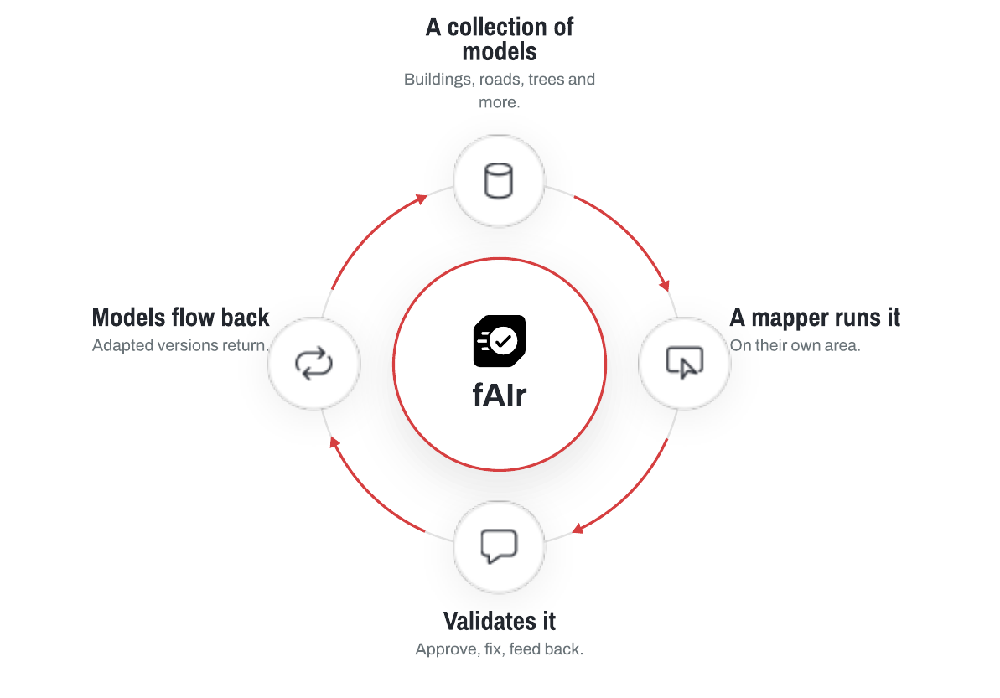

# fAIr

fAIr is a shared collection of open geo-AI models for humanitarian and development work, started by the Humanitarian OpenStreetMap Team (HOT) and built with community. A mapper picks a model, runs it over their own area to detect features such as buildings or trees, and checks the results. An advanced user can fine-tune the model for local conditions.

The software is free and open source. Predictions are suggestions for a mapper to review. fAIr offers its outputs as open data layers, and bringing AI-generated features into OpenStreetMap is outside its aim; see [fAIr and OpenStreetMap](overview/what-is-fair.md#fair-and-openstreetmap).

[:lucide-download: &nbsp; Download the fAIr explainer (PDF)](assets/downloads/fair-explainer.pdf){ .md-button download }

## Where fAIr is today

Current figures are on [Milestones](progress/milestones.md), and the direction ahead on [Vision](overview/where-fair-is-going.md).

## Who it is for

- :lucide-mouse-pointer-click: &nbsp; **Mapper**

    ---

    Picks a model and runs it on their own area, then validates the results.

    [:lucide-arrow-right: Learn more](overview/who-uses-it.md#mapper)

- :lucide-square-pen: &nbsp; **Advanced user**

    ---

    Retrains a model for their area and publishes the local model.

    [:lucide-arrow-right: Learn more](overview/who-uses-it.md#advanced-user)

- :lucide-box: &nbsp; **Developer**

    ---

    Writes new geo-AI models and adds them to fAIr for others to use.

    [:lucide-arrow-right: Learn more](overview/who-uses-it.md#developer)

## Start here

- :lucide-help-circle: &nbsp; **What is fAIr**

    ---

    What it is and why it exists.

    [:lucide-arrow-right: Open](overview/what-is-fair.md)

- :lucide-workflow: &nbsp; **How it works**

    ---

    The model loop and the data pipeline.

    [:lucide-arrow-right: Open](overview/how-it-works.md)

- :lucide-boxes: &nbsp; **Models**

    ---

    What fAIr can map, and the open model catalog.

    [:lucide-arrow-right: Open](overview/models.md)

- :lucide-book-open: &nbsp; **Using fAIr**

    ---

    Run a model on your own area and get the results.

    [:lucide-arrow-right: Open](guides/using-fair.md)

- :lucide-terminal: &nbsp; **Developer setup**

    ---

    Run the full stack locally and start iterating.

    [:lucide-arrow-right: Open](guides/developer-setup.md)

- :lucide-database: &nbsp; **Datasets**

    ---

    Published training and prediction data.

    [:lucide-arrow-right: Open](datasets/index.md)

- :lucide-map: &nbsp; **Roadmap**

    ---

    History and what is planned next.

    [:lucide-arrow-right: Open](roadmap/index.md)

