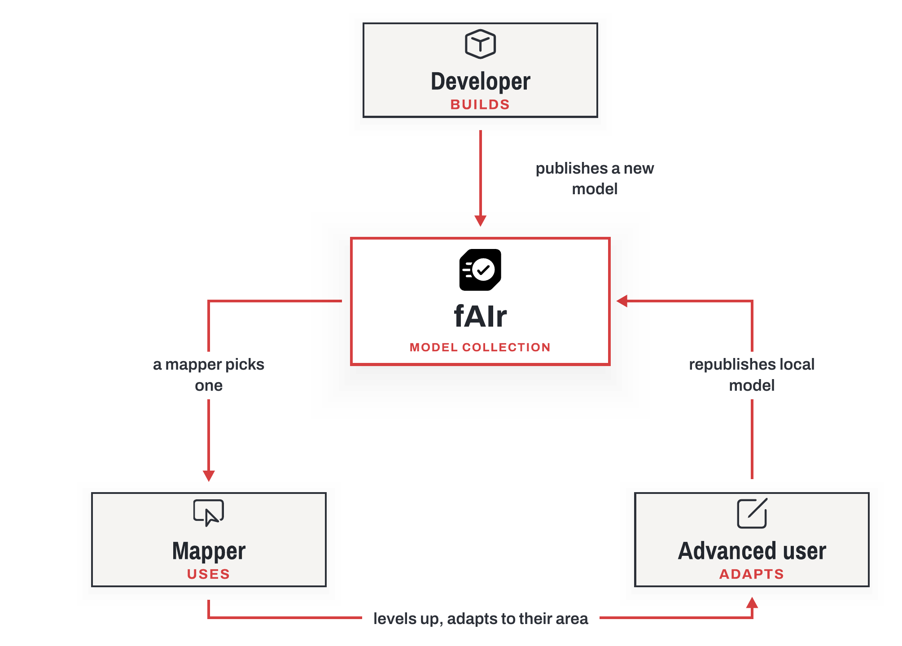
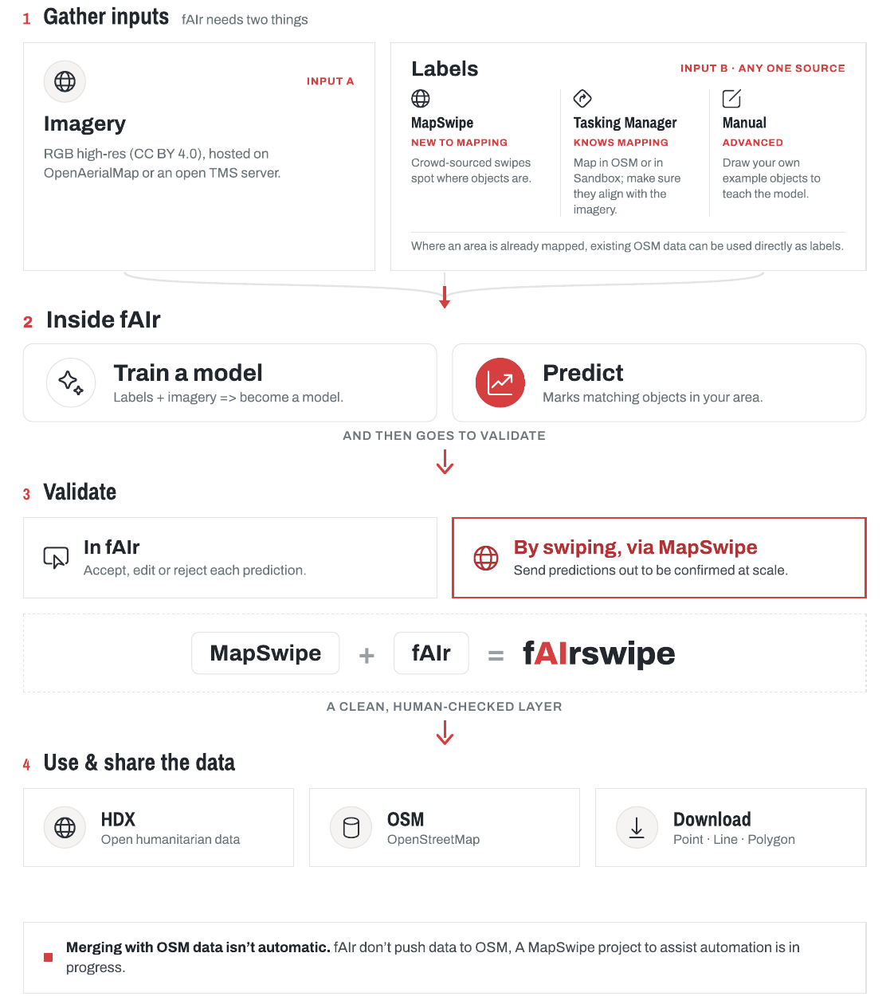

# How it works

fAIr has two connected cycles: a **model loop**, where models are shared, run, and improved, and a **data pipeline**, where imagery and labels become predictions that people validate and reuse.

## The model loop

A model starts in the shared collection. A mapper runs it over their own area and reviews the output. When someone retrains a model for a specific area, the local version is published back to the collection, so the next mapper can start from it.

The loop has four steps:

1. A **collection of models** is shared with everyone.
2. A **mapper runs** a model on their own area.
3. They **validate** the results: approve, fix, and feed back.
4. Improved or locally adapted **models flow back** to the collection.

The three roles that meet fAIr at this loop are described in [User bases](who-uses-it.md).

## The data pipeline

A model is only as good as the examples it learns from. fAIr takes labels and imagery, produces predictions, lets people validate them, and returns clean results.

### 1. Inputs

fAIr needs two things:

- **Imagery.** Openly licensed, very high-resolution RGB imagery from [OpenAerialMap](https://openaerialmap.org/) (which uses CC BY 4.0) or an open TMS source (a tiled imagery server).
- **Labels.** Examples that teach the model what to find: existing OpenStreetMap features in the area, finding where objects are with [MapSwipe](validation.md#finding-training-data-with-mapswipe) as a starting point, for those new to mapping, tracing in HOT's [Tasking Manager](https://tasks.hotosm.org/) for experienced mappers, or features drawn by hand for advanced users. [Prepare training data](../guides/training-data.md) covers how many labels a fine-tune needs.

### 2. Inside fAIr

Labels and imagery are used to train a model. A trained model then predicts matching features across a chosen area and returns them as GeoJSON, a common open format for map features.

### 3. Validate

Predictions are reviewed before they are used. A mapper can check them on fAIr's map or in QGIS, verify them on the ground with [FieldTM](https://field.hotosm.org/) (with QField), or confirm them at scale through MapSwipe Validate Footprints projects; see [Validation](validation.md).

### 4. Use and share

Predictions can be downloaded as points, lines, or polygons. HOT publishes validated outputs as open data layers on the [Humanitarian Data Exchange](https://data.humdata.org/) and [Hugging Face](https://huggingface.co/hotosm). See [Datasets](../datasets/index.md) for the published outputs.

Bringing AI-generated features into OpenStreetMap is outside fAIr's aim; see [fAIr and OpenStreetMap](what-is-fair.md#fair-and-openstreetmap).
