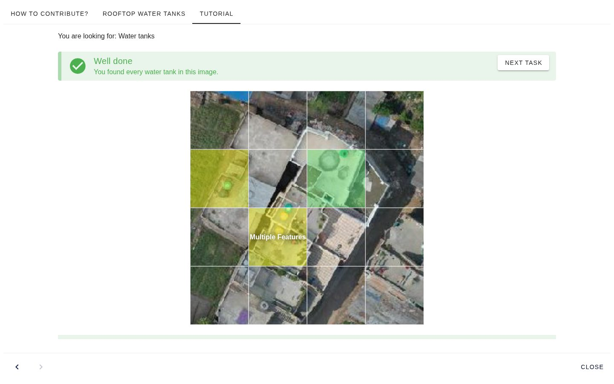
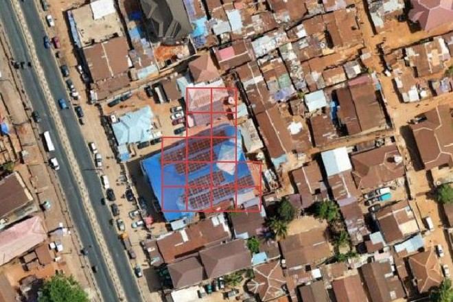

# Validation

An AI model makes mistakes: it can mark bare ground as a roof, or call a standing house destroyed. People can check its predictions before they are used. fAIr does this check at scale with [MapSwipe](https://mapswipe.org/), an open app where volunteers answer quick questions about imagery on their phone or on the web.

## How it works

1. **fAIr predicts.** A model returns shapes on a map, such as building outlines, or a label for existing shapes, such as the damage to each building.
2. **The shapes go to MapSwipe.** The mapping team creates a MapSwipe project of the type [Validate Footprints](https://docs.mapswipe.org/project_types/validate_footprints/) with those shapes and one question, such as "Does the outline trace the building?"
3. **Volunteers answer.** MapSwipe shows one shape at a time over the imagery, and the volunteer taps **Yes**, **No** or **Not sure**. Each shape is shown to several volunteers.
4. **The answers decide.** In the [MapSwipe Results Analyzer](https://hotosm.github.io/mapswipe-results-analyzer/), a shape is accepted by default when more than half of its answers are Yes; the share can be changed.
5. **The results are shared.** All answers are published as [open data](https://mapswipe.org/en/data/), and the accepted shapes can be downloaded.

## Example: building outlines in Freetown

A fAIr model outlined buildings in Freetown, Sierra Leone, on drone imagery from OpenAerialMap. A MapSwipe project asked volunteers to mark an outline as correct if it accurately traces the building.

- **8,565** fAIr outlines, most seen by **3** or **4** volunteers
- **410** volunteers gave **32,831** answers
- **2,456** outlines accepted, **3,260** rejected, and **2,849** with no clear majority

The rejected outlines show what the model still gets wrong, and the accepted ones can be used. To explore the results on a map, open the project in the [MapSwipe Results Analyzer](https://hotosm.github.io/mapswipe-results-analyzer/?p=01KRX0MG38NRVWM0C03E9H9X4A&t=50): choose the share of Yes answers an outline needs, and download the accepted outlines as GeoJSON. The project itself is on [MapSwipe](https://mapswipe.org/en/projects/01KRX0MG38NRVWM0C03E9H9X4A/).

## Example: damage labels after the Nepal floods

After the [August 2026 floods in Nepal](../progress/activations.md#nepal-floods-2026), a fAIr model labelled the damage to each building mapped in OpenStreetMap. A MapSwipe project showed **6,096** of these buildings over imagery taken after the flood, and **1,775** volunteers, about **30** per building, answered whether they could see the building. Comparing their answers with fAIr's labels:

| fAIr's label      | Buildings | Most volunteers saw it | Most did not see it | No clear majority |
| ----------------- | --------- | ---------------------- | ------------------- | ----------------- |
| Destroyed         | 183       | 2                      | 100                 | 81                |
| No visible damage | 4,160     | 2,830                  | 429                 | 901               |

Buildings labelled major damage, minor damage or no data are not shown.

For 2 of the 183 buildings fAIr called destroyed, most volunteers saw a standing building. The 429 buildings fAIr called undamaged that volunteers could not see are the ones to review by hand. See the [results](https://hotosm.github.io/mapswipe-results-analyzer/?p=01M28PS0JGQ6RHFRTJDGCAX91H&t=50) and the [project](https://mapswipe.org/en/projects/01M28PS0JGQ6RHFRTJDGCAX91H/).

MapSwipe has also checked fAIr damage predictions after the earthquakes in Colombia and Venezuela; see [Activations](../progress/activations.md).

## Limits

- Volunteers only see the shapes they are given. A building the model missed is never shown, so it is not caught here; [Evaluation](evaluation.md) covers how missed features are measured.
- A No marks a shape as wrong but does not redraw it.
- Volunteers see one image. Showing imagery from before and after an event, so they can compare, is in development for Validate Footprints ([MapSwipe backend](https://github.com/mapswipe/mapswipe-backend/pull/290), [MapSwipe data model](https://github.com/mapswipe/mapswipe-firebase/pull/62)).

## Finding training data with MapSwipe

MapSwipe is also used before a model is trained, to find where an object appears. In a [Locate Objects](https://docs.mapswipe.org/project_types/locate_objects/) project, MapSwipe shows an imagery tile split into a grid of squares, and volunteers tap each square that contains the object.

The squares that most volunteers marked show where the objects are. A square shows that an object is there, not its outline, so the squares are a starting point for a training dataset; fAIr does not import them directly.

For example, 221 volunteers looked for rooftop solar panels in Freetown, Sierra Leone ([project](https://mapswipe.org/en/projects/01M4XM3A1B2WV1T04A8SHV2DBK/)). The [Locate results helper](https://hotosm.github.io/mapswipe-locate-tutorials/builder/results.html?results=https://backend.mapswipe.org/media/project/3451/asset/export/01M4XMNSMS88HMY96H3P356DR0/agg_results_by_task_3451.csv.gz) shows the results on a map and downloads the marked squares as GeoJSON.

The [MapSwipe Locate tutorials](https://hotosm.github.io/mapswipe-locate-tutorials/) explain how to set up such a project, step by step. Community projects that use MapSwipe with fAIr, called fAIrSwipe, are listed on [Field projects](../progress/field-projects.md).
