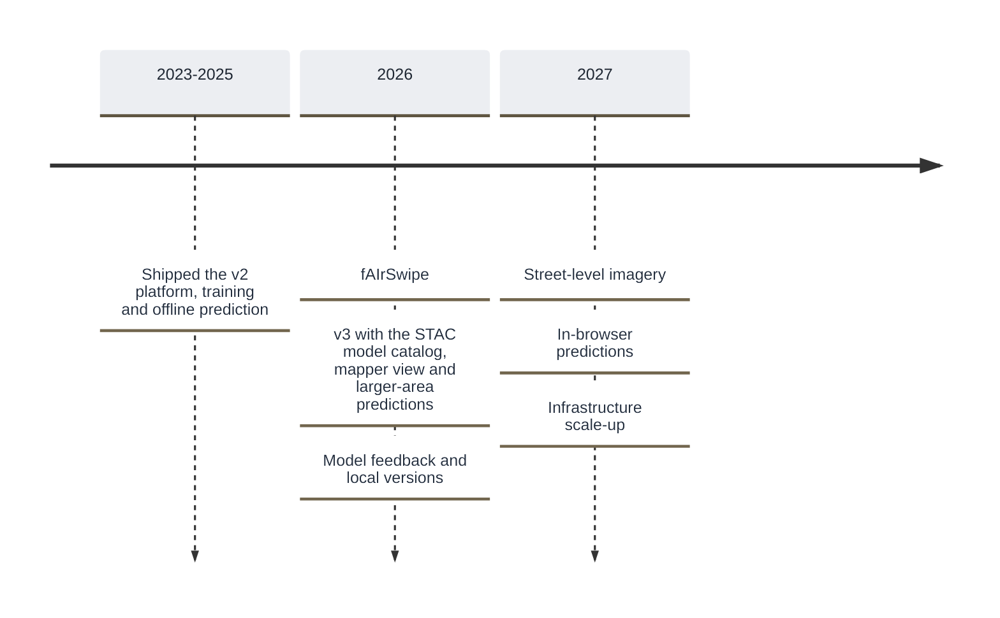

# Roadmap

Where fAIr came from, what has shipped, and what is being worked on. For the bigger picture and how fAIr is positioned, see [Vision](../overview/where-fair-is-going.md).

## Timeline

Current figures for each effort are tracked on the [Milestones](../progress/milestones.md) page.

## Now and later

- :lucide-circle-check: &nbsp; **Released in v3.0.0 (October 2026)**

    ---

    - Mapper view: pick any model, apply it to any imagery, and see the results
    - Prediction requests over larger areas, with size limits
    - A result view for each map request
    - Running at [dev.ai.hotosm.org](https://dev.ai.hotosm.org/), moving to [ai.hotosm.org](https://ai.hotosm.org/)

- :lucide-circle-dashed: &nbsp; **Next, targeted for the end of 2026**

    ---

    - Feedback on model results
    - Screens to improve a model with more training data and create a local version
    - Rating a model

## Exploring next year

Options under exploration for 2027.

- Street-level imagery
- Scaling up the infrastructure and stabilizing the server
- In-browser predictions
- A public STAC endpoint on the production instance

!!! note "This roadmap is a living summary"

    Item order and grouping are indicative. The live board is at [hotosm/projects/40](https://github.com/orgs/hotosm/projects/40).

## Shipped

Capabilities already released, with the release series in which each landed.

| Capability                                                   | Release  |
| ------------------------------------------------------------ | -------- |
| Adopting the YOLOv8 model                                    | v2.0.1+  |
| Redesigned interface                                         | v2.0.10+ |
| User profiles and activity                                   | v2.1.0   |
| Notifications on training status                             | v2.1.3   |
| Replicable models (run a model on new imagery or a new area) | v2.2.0   |
| Offline AI prediction                                        | v2.2.3   |
| Post-processing of predicted geometry                        | v2.2.4   |
| fAIrSwipe (validate predictions via MapSwipe)                | v2.2.15  |
| STAC model catalog, mapper view, larger-area predictions     | v3.0.0   |

The current release series is v3.0.x.
